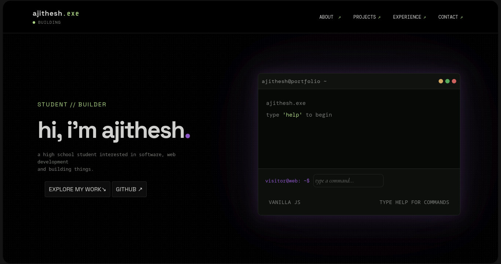
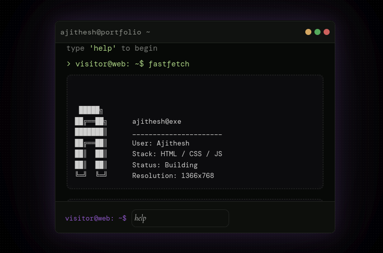
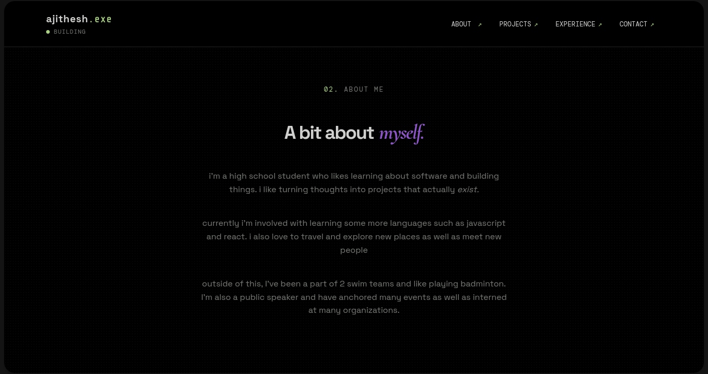
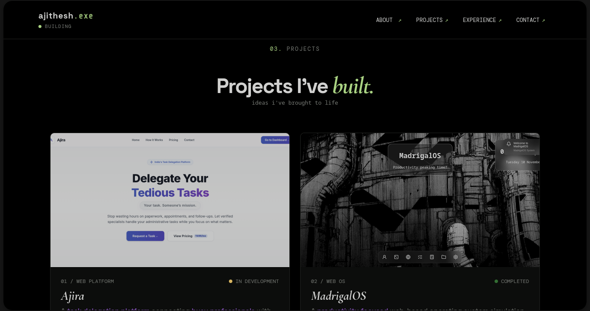
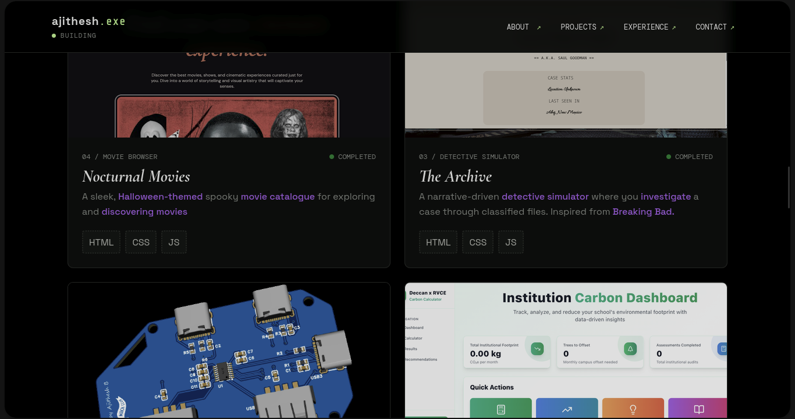
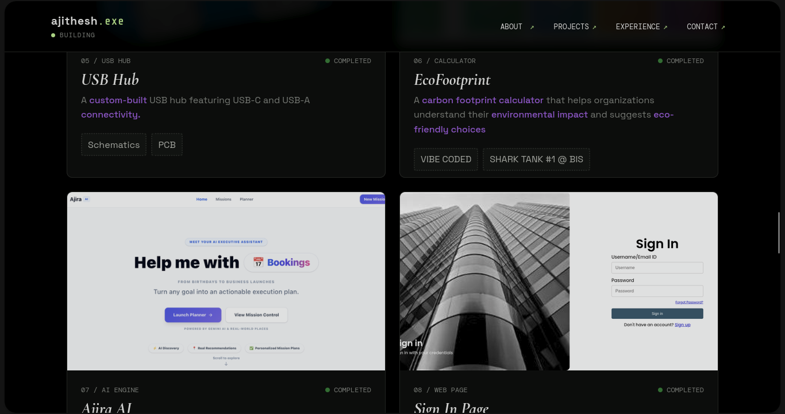
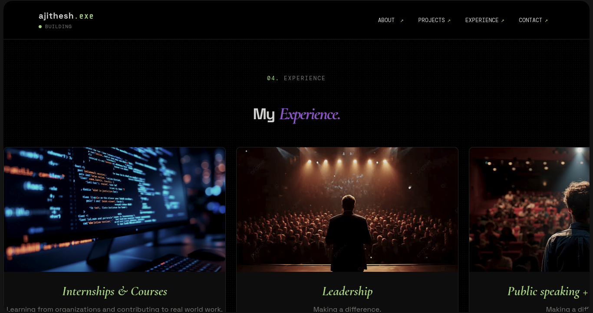
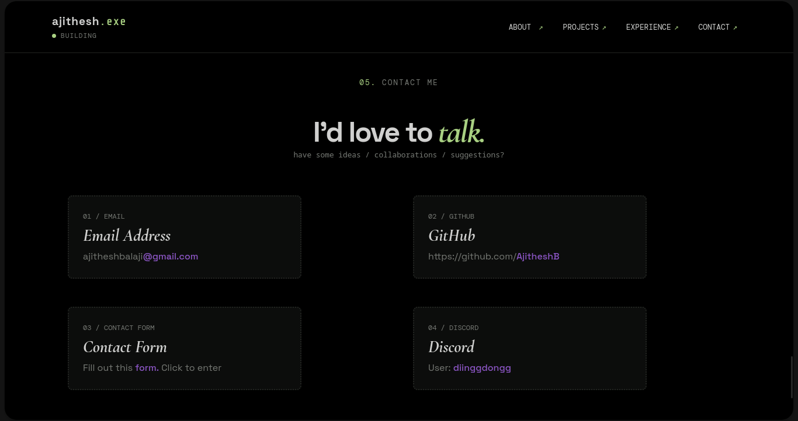

# ajithesh.exe - A Portfolio

#### ajithesh.exe is a my very own portfolio website featuring an interactive terminal + a web-developer purple & green theme

Built using HTML, JS and a lot of CSS

## Hero

## Interactive terminal

## About Me

## Projects

## Experience

## Contact

---

## How to access/run
Go to https://ajithesh.exe.vercel.app to access my portfolio!

Currently only functions on computers (mobile coming soon!)

## The story behind ajithesh.exe

so all my projects for HackClub Terra have been mostly either a terminal or a webOS so I decided it was time to switch things up.

So I spent some time thinking about ideas but then I realized I'd been procrastinating creating a portfolio for so long....

I'd made one a while back but the CSS on it is TERRIBLE since it was like 5 years ago.

So, with some mind-mapping I decided to make a hacker themed sort of portfolio website with an interactive terminal (I can't make a project without a terminal...)

### And there we have it, ajithesh.exe! (I have to change the name it sounds like a virus...)